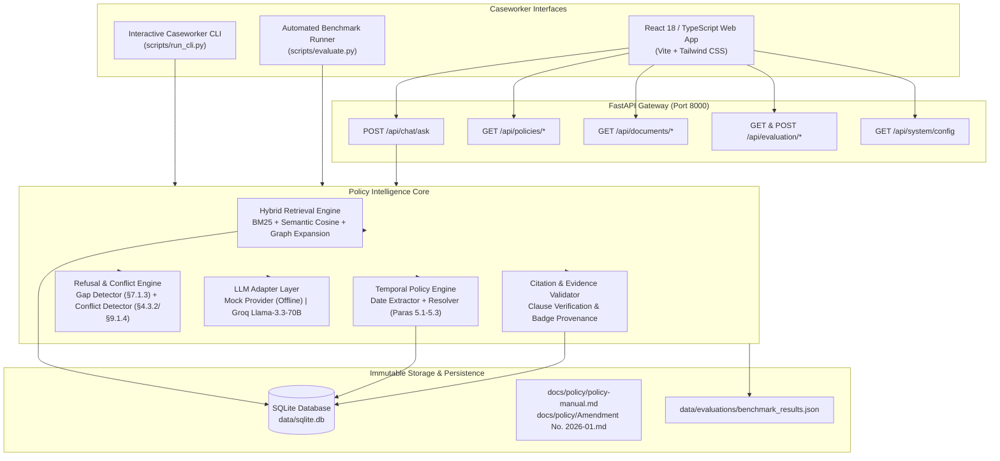

# THE GROUNDED ANSWER
### An Evidence-Grounded Policy Intelligence Assistant for Public Welfare Caseworkers

[](file:///Users/sivabalan/Documents/GROUNDED%20ANSWER%20RAG/backend/tests)
[-blue?style=flat-square&logo=checkmarx)](file:///Users/sivabalan/Documents/GROUNDED%20ANSWER%20RAG/data/evaluations/benchmark_results.json)
[](file:///Users/sivabalan/Documents/GROUNDED%20ANSWER%20RAG/frontend)
[](file:///Users/sivabalan/Documents/GROUNDED%20ANSWER%20RAG/docs/policy)
[](#)

---

## 1. Project Overview & Problem Statement

**The Grounded Answer** is an evidence-grounded policy intelligence web application and interactive CLI built from scratch for caseworkers administering the **Calder County Household Support Program (HSP)**.

Public assistance determinations involve high-stakes statutory rules: eligibility thresholds, resource limits, earned income disregards, sanction percentages, and reporting windows. Traditional conversational chatbots hallucinate non-existent welfare rules, fabricate citations, make dangerous assumptions about the current date, and cannot handle retroactive amendments.

The Grounded Answer solves this through a **Single Source of Truth Doctrine**:
1. **Zero Policy Fabrication:** Every answer is synthesized strictly from retrieved clauses in the consolidated Policy Manual and Amendment No. 2026-01.
2. **Effective-Dated Overlay Architecture:** Enforces statutory transitional rules (Paras 5.1, 5.2, 5.3) based on explicit determination dates, change of circumstance dates, and spanning claim periods—never substituting "today's date".
3. **The Doctrine of Responsible Refusal:** Automatically detects and refuses drafting omissions (*apparent gaps* like the §7.1.3 student trap) and statutory contradictions (*internal conflicts* like §4.3.2 vs §9.1.4), directing caseworkers to policy leadership rather than guessing.
4. **Verifiable Citation Provenance:** Extracts and verifies every cited clause against the ingested SQLite corpus, tagging amended provisions with amendment action numbers.
5. **Auditable Evaluation Suite:** Features a built-in 10-Question Benchmark Suite measuring factual accuracy, citation validity, and refusal correctness.

---

## 2. System Architecture

The project is structured as a high-performance modular monolith with clean separation across ingestion, retrieval, temporal reasoning, refusal management, generation, API routing, web UI, and CLI tooling.



---

## 3. Technology Stack

| Layer | Technologies & Rationale |
| :--- | :--- |
| **Frontend** | React 18, TypeScript 5, Vite 5, Tailwind CSS 3, TanStack Query v5, Lucide Icons. Clean, high-density light theme designed for caseworkers (guided by `npx ui-skills`). |
| **Backend** | Python 3.14 / 3.11+, FastAPI 0.115, Pydantic v2.10, Uvicorn 0.32. Async modular architecture with strict request/response data contracts. |
| **Retrieval** | Okapi BM25 with term stemming, deterministic semantic cosine embeddings, and statutory cross-reference graph expansion. |
| **Temporal Engine** | Regex date extractors, effective-dated overlay resolver, §7.4.3 daily award apportioner for spanning claims. |
| **Storage** | SQLite (`data/sqlite.db`) for indexed policy clauses, amendment actions, document metadata, and evaluation results. Original Markdown files preserved as immutable source truth. |
| **LLM Providers** | Pluggable provider adapter: Deterministic Mock Provider (zero-quota, 100% offline reproducible) and Groq Cloud Llama-3.3-70B-Versatile adapter. |
| **Evaluation** | Automated 10-Question Benchmark Suite with honest database and JSON persistence (`data/evaluations/benchmark_results.json`). |

---

## 4. Quickstart & Clean-Clone Reproduction Guide

Follow this guide to get the complete application running in under 3 minutes.

### 4.1 Prerequisites
- **Python:** Python 3.10 or higher (Python 3.11–3.14 tested)
- **Node.js:** Node.js 18 or higher & `npm`
- **Git**

### 4.2 Step-by-Step Installation

```bash
# 1. Clone the repository
git clone https://github.com/your-username/the-grounded-answer.git
cd the-grounded-answer

# 2. Configure Environment
cp .env.example .env
# Optional: add your GROQ_API_KEY to .env (Default is mock deterministic mode)

# 3. Setup Python Virtual Environment & Dependencies
python3 -m venv .venv
source .venv/bin/activate
pip install -r backend/requirements.txt

# 4. Ingest Official Policy Documents into SQLite
python scripts/ingest.py
# Ingests 148 clauses across 12 Parts and 9 amendment items into data/sqlite.db

# 5. Run Backend Unit & Integration Tests (44 tests)
PYTHONPATH=backend pytest backend/tests/

# 6. Install Frontend Dependencies & Build Production Bundle
cd frontend
npm install
npm run build
cd ..
```

### 4.3 Running the Services

#### Terminal 1: Backend API Gateway
```bash
source .venv/bin/activate
PYTHONPATH=backend uvicorn app.main:app --host 0.0.0.0 --port 8000 --reload
# API Gateway live at http://127.0.0.1:8000 (Docs: http://127.0.0.1:8000/docs)
```

#### Terminal 2: Casework Web Application
```bash
cd frontend
npm run dev
# Casework Assistant UI live at http://localhost:5173
```

#### Terminal 3: Interactive Caseworker CLI
```bash
source .venv/bin/activate
python scripts/run_cli.py
```

#### Terminal 4: Standalone Benchmark Suite Runner
```bash
source .venv/bin/activate
python scripts/evaluate.py
```

---

## 5. Website Walkthrough (8 Modules)

The web frontend is designed around the principles of **evidence transparency** and **casework workflow efficiency** (documented in [`frontend/DESIGN.md`](file:///Users/sivabalan/Documents/GROUNDED%20ANSWER%20RAG/frontend/DESIGN.md)):

1. **Dashboard (`/`):** Casework overview, corpus metrics (148 clauses, 12 parts), active amendment overlay badge, and 6 quick-start casework scenarios.
2. **Casework Assistant (`/assistant`):** Primary 3-panel chat workspace. Features natural language input, collapsible temporal context controls (Determination Date, Change Date, Claim Period), direct answer callout, supporting citation pills, supervisory gate warnings, and real-time evidence inspector drawer.
3. **Policy Explorer (`/explorer`):** Hierarchical 12-Part tree navigation, live text search, "Show Amended Clauses Only" filter, verbatim statutory text reader, and historical baseline diff viewer.
4. **Timeline & Amendments (`/timeline`):** Visual enactment and effective date timeline (31 Dec 2025 $\rightarrow$ 12 Feb 2026 $\rightarrow$ 1 Mar 2026), interactive breakdown of Paragraphs 5.1, 5.2, and 5.3, and a live transitional policy rule simulator.
5. **Benchmark Evaluation (`/evaluation`):** Real-time execution dashboard for the 10-Question Benchmark Suite. Displays accuracy (100%), citation validity (100%), refusal correctness (100%), average latency (~1.7ms), and an expandable 10-case test matrix.
6. **Source Documents (`/documents`):** Immutable repository displaying `policy-manual.md` and `Amendment No. 2026-01.md` with SHA-256 cryptographic checksums, byte sizes, and full-screen read-only viewer.
7. **Settings & Config (`/settings`):** Active provider display, target model details, hybrid retrieval parameters, and client-side secret isolation guarantee.
8. **About & Methodology (`/about`):** Detailed breakdown of the Single Source of Truth doctrine, the 5 refusal categories, the full-time student gap trap, and pre-amendment reporting inconsistencies.

---

## 6. Interactive Caseworker CLI (`scripts/run_cli.py`)

The terminal interface provides caseworkers with an offline, distraction-free environment:
- Natural language query prompts with optional date inputs (Determination Date, Change Date, Claim Start/End).
- Colorized evidence envelope displaying status, direct answer, policy explanation, citations, and supervisory warnings.
- Built-in commands:
  - `presets`: Launch standard benchmark scenarios.
  - `clause <id>`: Inspect verbatim clause text, amendment action, and cross-references (e.g. `clause §6.4.1(a)`).
  - `eval`: Run the 10-Question Benchmark Suite directly in terminal.
  - `clear`: Clear console screen.
  - `exit`: Terminate session.

---

## 7. Ten-Question Benchmark Suite Walkthrough

The application includes an automated benchmark evaluating 10 critical casework scenarios. All results are genuine and persisted to `data/evaluations/benchmark_results.json`.

| Test ID | Category | Query / Subject | Expected Outcome | Rationale & Statutory Grounding |
| :--- | :--- | :--- | :--- | :--- |
| **TEST-01** | Direct Grounding | Maximum countable resources limit | `ANSWERED` | Direct inquiry testing resource ceiling under §2.4.1 ($4,000 maximum). |
| **TEST-02** | Multi-Clause Gate | Independent 16-year-old applicant | `ANSWERED_WITH_WARNING` | Youth eligibility exception under §2.3.1 triggers mandatory supervisory referral warning under §2.3.2. |
| **TEST-03** | Pre-Amendment Rates | Earnings disregard for determination on 15 Feb 2026 | `ANSWERED_WITH_WARNING` | Resolves pre-amendment disregard ($120/mo under §6.4.1(a)) with pre-amendment text advisory. |
| **TEST-04** | Post-Amendment Rates | Earnings disregard for determination on 15 Mar 2026 | `ANSWERED` | Resolves amended disregard ($175/mo under §6.4.1(a)) with Amendment No. 2026-01 Item 1.1 provenance. |
| **TEST-05** | Transitional Split | Change occurred 10 Feb 2026, determination 20 Mar 2026 | `ANSWERED_WITH_WARNING` | Dual rule: Disregard is $175 (determination date $\ge$ 1 Mar 2026 per Para 5.1), but reporting deadline is 10 days (change occurred prior to 1 Mar 2026 per Para 5.2). |
| **TEST-06** | Spanning Claim | Claim period 15 Feb 2026 to 15 Mar 2026 | `ANSWERED_WITH_WARNING` | Daily award apportionment under §7.4.3 per Para 5.3: 14 days at 2025 baseline rates, 15 days at amended rates. |
| **TEST-07** | Internal Inconsistency | Pre-amendment deadline to prevent overpayment | `REFUSED` (`INTERNAL_CONFLICT`) | Challenge Trap: Refuses pre-amendment contradiction between §4.3.2 (10 days) and §9.1.4 (30-day safe harbor). Advises supervisor referral. |
| **TEST-08** | Apparent Gap | Needs calculation for full-time student under §7.1.3 | `REFUSED` (`APPARENT_GAP`) | Challenge Trap: §7.1.3 erroneously points to care allowances in §5.4; manual contains zero student rules. System refuses and directs case to Policy Leadership. |
| **TEST-09** | Out of Scope | Commercial business economic expansion grant | `REFUSED` (`OUT_OF_SCOPE`) | Ineligible non-household commercial inquiry refused with appropriate community referral next step. |
| **TEST-10** | Missing Temporal Data | Monthly income threshold for household of 3 | `REFUSED` (`MISSING_TEMPORAL_DATA`) | Rate changed under Amendment No. 2026-01 ($2,000 to $2,075). Without determination date, system refuses rather than assuming today's date. |

---

## 8. Environment Variables

| Variable | Default Value | Description |
| :--- | :--- | :--- |
| `APP_NAME` | `The Grounded Answer` | Human-readable application name |
| `APP_ENV` | `development` | Runtime environment (`development`, `production`) |
| `DEFAULT_PROVIDER` | `mock` | Default LLM provider adapter (`mock`, `groq`) |
| `GROQ_API_KEY` | *(empty string)* | Groq API Key (never exposed to client) |
| `GROQ_MODEL` | `llama-3.3-70b-versatile` | Target Groq model |
| `DATABASE_URL` | `sqlite:///data/sqlite.db` | Path to SQLite database |
| `RETRIEVAL_TOP_K` | `5` | Number of clauses retrieved per query |
| `SIMILARITY_THRESHOLD` | `0.20` | Cut-off threshold for off-topic query refusal |
| `HYBRID_RETRIEVAL` | `True` | Enable combined BM25 + Vector + Graph search |

---

## 9. Verification & Automated Quality Assurance

Run the complete QA validation suite:

```bash
# 1. Run all 44 backend pytest tests
PYTHONPATH=backend pytest backend/tests/ -v

# 2. Run frontend production build
npm run build --prefix frontend

# 3. Run standalone benchmark evaluation
python scripts/evaluate.py
```

Expected result: 44 backend tests passed, frontend compiled in under 1 second, 10/10 benchmark tests passed.
