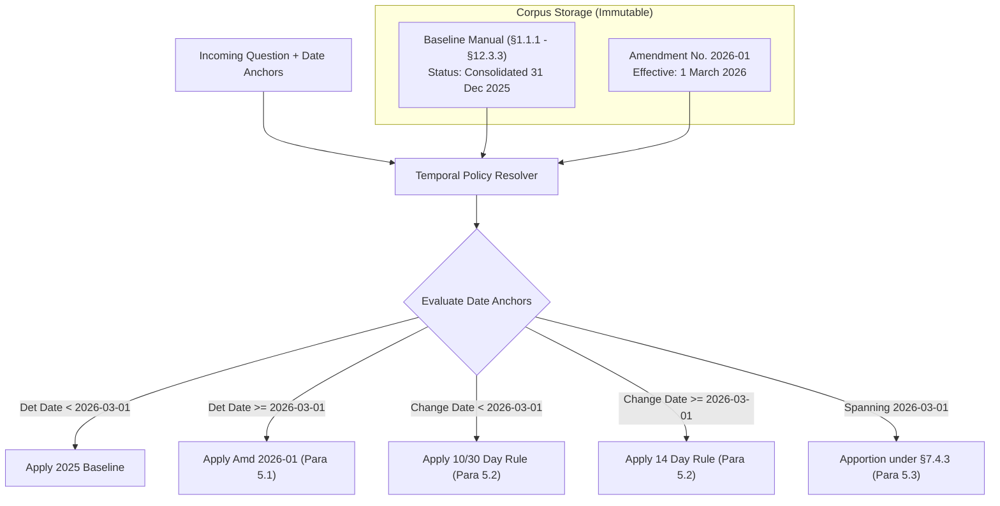

# Amendment No. 2026-01 & Temporal Policy Analysis
**Calder County Household Support Program (HSP)**  
*Document Version: 1.0.0 — Phase 0 Analysis*  
*Enactment Date: 12 February 2026 | Effective Date: 1 March 2026*  
*Legal Authority: Enacted under §1.2.3 of the HSP Policy Manual*

---

## 1. Overview and Architectural Overlay Principle

Amendment No. 2026-01 introduces substantive policy modifications, rectifies an internal statutory conflict, and enacts strict transitional provisions. 

### 1.1 Effective-Dated Overlay Architecture
In compliance with non-negotiable architectural rules, **the original consolidated policy manual is never mutated in place**. 

Instead, the system implements an **effective-dated policy overlay**:
- **Baseline Layer:** Consolidated text as at 31 December 2025 (`corpus_id: HSP-2025-12`).
- **Overlay Layer:** Amendment No. 2026-01 (`corpus_id: HSP-AMD-2026-01`).
- **Resolver Engine:** Dynamically selects, merges, or splits clauses based on temporal inputs (Determination Date, Change of Circumstance Date, and Claim Start/End Dates).

---

## 2. Itemized Provision Amendments

### 2.1 Paragraph 1: Earnings Disregard
- **Clause Target:** §6.4.1(a)
- **Baseline Text:** First **$120 per month** of household earnings from employment.
- **Amended Text:** First **$175 per month** of household earnings from employment.
- **Delta:** $+\$55$ increase in monthly disregarded earned income.
- **Governing Transitional Rule:** **Paragraph 5.1** (Determination Date rule).

### 2.2 Paragraph 2: Reporting Changes of Circumstances
- **Clause Targets:** §4.3.2 and §9.1.4
- **Baseline §4.3.2:** Report within **10 calendar days** of change or awareness.
- **Amended §4.3.2:** Report within **14 calendar days** of change or awareness.
- **Baseline §9.1.4:** Safe harbor from overpayment if reported within the **30 calendar days** required under §4.3.
- **Amended §9.1.4:** Safe harbor from overpayment if reported within **14 calendar days**.
- **Official Policy Note:** The amendment explicitly notes that §9.1.4 previously failed to correspond to §4.3.2, and this amendment aligns both to 14 days.
- **Governing Transitional Rule:** **Paragraph 5.2** (Change of Circumstances Occurrence Date rule).

### 2.3 Paragraph 3: Income Thresholds Table
- **Clause Target:** §6.6.1
- **Comparative Threshold Table:**

| Household Size | Pre-Amendment Threshold (2025) | Amended Threshold (1 Mar 2026) | Absolute Increase | Percentage Increase |
|:---|:---|:---|:---|:---|
| **1** | $1,180 | **$1,225** | +$45 | +3.81% |
| **2** | $1,590 | **$1,650** | +$60 | +3.77% |
| **3** | $2,000 | **$2,075** | +$75 | +3.75% |
| **4** | $2,410 | **$2,500** | +$90 | +3.73% |
| **5** | $2,820 | **$2,925** | +$105 | +3.72% |
| **Each Add'l** | +$410 | **+$425** | +$15 | +3.66% |

- **Governing Transitional Rule:** **Paragraph 5.1** (Determination Date rule).

### 2.4 Paragraph 4: Sanctions and New Protections
- **Clause Targets:** §10.5.2 and new clause §10.5.3A
- **Baseline §10.5.2:** Sanction reduction is **20 per cent** of monthly award.
- **Amended §10.5.2:** Sanction reduction is **15 per cent** of monthly award (a 5 percentage point reduction).
- **New Clause §10.5.3A:**
  > *"A sanction must not be imposed in respect of a failure to report where the change of circumstances in question would have increased the award."*
- **Significance:** Adds a vital equitable defense for recipients. If an unreported change (e.g., loss of a job or birth of a child) would have resulted in a higher benefit, the Department is strictly prohibited from imposing a sanction.
- **Governing Transitional Rule:** **Paragraph 5.1** (Determination Date rule).

---

## 3. Transitional Provisions — The Three Governing Rules

The core complexity of Day Two lies in Paragraph 5. The system must never confuse the three distinct transitional mechanisms:

### 3.1 Rule 1: The Determination Date Rule (Paragraph 5.1)
> *"The amendments made by paragraphs 1, 3 and 4 apply to any determination made on or after 1 March 2026, including a determination in respect of a period before that date."*

- **Applicable Domains:**
  1. Earnings Disregard (§6.4.1(a) $\rightarrow \$175$)
  2. Income Thresholds (§6.6.1 $\rightarrow$ Revised Table)
  3. Sanction Percentage (§10.5.2 $\rightarrow 15\%$)
  4. Increased-Award Sanction Exemption (§10.5.3A)
- **Trigger Test:**
  $$\text{Is Determination Date } T_{\text{det}} \ge \text{2026-03-01}?$$
  - If **YES**: Use amended rates ($175 disregard, revised thresholds, 15% sanction, §10.5.3A applies), **even if the claim period is November 2025 or January 2026**.
  - If **NO** ($T_{\text{det}} < \text{2026-03-01}$): Use baseline 2025 rates ($120 disregard, old thresholds, 20% sanction, no §10.5.3A).

### 3.2 Rule 2: The Occurrence Date Rule (Paragraph 5.2)
> *"The amendments made by paragraph 2 apply only in respect of a change of circumstances occurring on or after 1 March 2026. Where the change of circumstances occurred before 1 March 2026, the reporting period is the period that applied at the date of the change, irrespective of the date of the determination."*

- **Applicable Domain:** Reporting Period for Changes of Circumstances (§4.3.2 and §9.1.4).
- **Trigger Test:**
  $$\text{Is Date of Change } T_{\text{change}} \ge \text{2026-03-01}?$$
  - If **YES**: The recipient has **14 calendar days** to report (§4.3.2), and the safe harbor under §9.1.4 is 14 calendar days.
  - If **NO** ($T_{\text{change}} < \text{2026-03-01}$): The pre-amendment reporting rules apply **regardless of when the determination is made**. Under pre-amendment rules, §4.3.2 required **10 calendar days**, but §9.1.4 cited **30 calendar days**, preserving the internal inconsistency!

### 3.3 Rule 3: Spanning Claims Daily Apportionment (Paragraph 5.3 & §7.4.3)
> *"Where a claim relates to a period spanning 1 March 2026, the applicable figures are those in force on each day of the period, and the award is apportioned accordingly under §7.4.3."*

- **Applicable Domain:** Benefit calculations for claim periods $[T_{\text{start}}, T_{\text{end}}]$ where $T_{\text{start}} < \text{2026-03-01} \le T_{\text{end}}$.
- **Governing Apportionment Rule:** §7.4.3 states: *"An award of less than one month's duration is apportioned by reference to the number of days."*
- **Mathematical Formula:**
  Let $N$ be the total days in the claim period $[T_{\text{start}}, T_{\text{end}}]$.
  Let $N_1$ be the number of days prior to 1 March 2026 ($T < \text{2026-03-01}$).
  Let $N_2$ be the number of days on or after 1 March 2026 ($T \ge \text{2026-03-01}$), such that $N = N_1 + N_2$.
  
  For monthly awards:
  $$\text{Award}_{\text{spanning}} = \left( \frac{N_1}{N_{\text{month}}} \times \text{Award}_{\text{pre}} \right) + \left( \frac{N_2}{N_{\text{month}}} \times \text{Award}_{\text{post}} \right)$$
  Where $\text{Award}_{\text{pre}}$ uses pre-March rates and $\text{Award}_{\text{post}}$ uses post-March rates.

---

## 4. Master Scenario & Decision Matrix

The following truth table defines the deterministic behavior required for any combination of facts:

| Scenario ID | Determination Date ($T_{\text{det}}$) | Change / Claim Date ($T_{\text{event}}$) | Earnings Disregard | Income Thresholds | Reporting Period | Sanction Rate | Protection §10.5.3A Active? |
|:---|:---|:---|:---|:---|:---|:---|:---|
| **SC-A** | Prior to 1 Mar 2026 | Prior to 1 Mar 2026 | **$120** (§6.4.1(a)) | 2025 Table (§6.6.1) | **Conflict:** 10 days (§4.3.2) vs 30 days (§9.1.4) | **20%** (§10.5.2) | **NO** (Not enacted) |
| **SC-B** | On/after 1 Mar 2026 | On/after 1 Mar 2026 | **$175** (Amd 1.1) | 2026 Table (Amd 3.1) | **14 calendar days** (Amd 2.1, 2.2) | **15%** (Amd 4.1) | **YES** (Amd 4.2) |
| **SC-C** *(Transitional Split)* | On/after 1 Mar 2026 (e.g. 15 Mar 2026) | Prior to 1 Mar 2026 (e.g. 10 Feb 2026) | **$175** (Para 5.1 determination date rule) | 2026 Table (Para 5.1 determination date rule) | **Conflict:** 10 days (§4.3.2) vs 30 days (§9.1.4) per Para 5.2 | **15%** (Para 5.1 determination date rule) | **YES** (Para 5.1 determination date rule) |
| **SC-D** *(Spanning Claim)* | On/after 1 Mar 2026 | Period spanning 1 Mar 2026 | Apportioned daily (§7.4.3 & Para 5.3) | Apportioned daily (§7.4.3 & Para 5.3) | Depends on exact date change occurred | 15% | YES |
| **SC-E** *(Missing Dates)* | Unspecified | Unspecified | **Refuse / Clarify:** Cannot determine without determination date. Explain both $120 and $175 thresholds. |

---

## 5. Architectural Implementation Directives

1. **Temporal Resolver Service:** An explicit Python module `app.temporal.resolver` must compute the applicable policy version and clause adjustments before evidence is compiled for generation.
2. **Never Default to Current Date:** If the caseworker does not supply dates, the engine must never inject `datetime.now()`. It must request the dates or present a side-by-side conditional explanation.
3. **Audit Trail & Citations:** When an amended clause is cited, the citation badge must present the composite provenance, e.g.:
   - `§6.4.1(a) [Amended by Amd No. 2026-01 §1.1, effective 1 March 2026]`
   - Accompanied by the transitional rule reference `[Amd No. 2026-01 §5.1]`.

