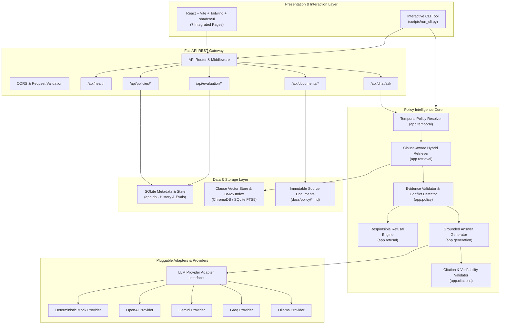
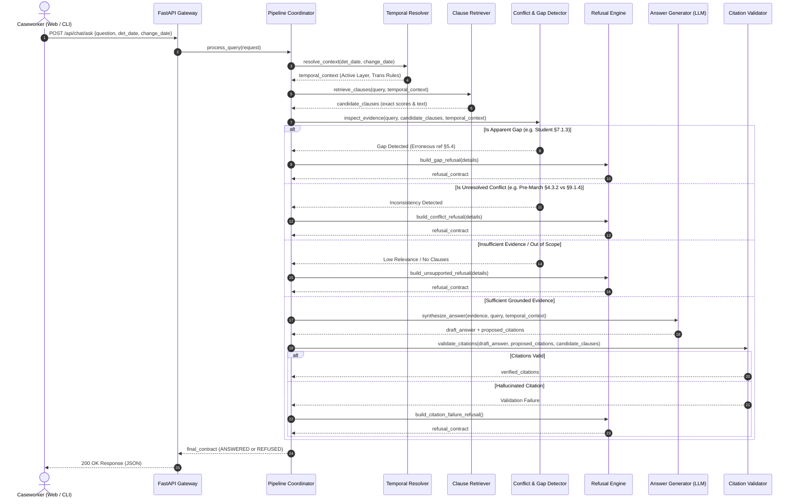

# System Architecture & Technical Design — The Grounded Answer
**An Evidence-Grounded Policy Intelligence Assistant**  
*Document Version: 1.0.0 — Phase 0 Architecture Design*  
*Target Environment: Python 3.11+ / FastAPI / React 18 / TypeScript / Vite / Tailwind CSS*

---

## 1. Architectural Philosophy & Principles

The Grounded Answer is architected as a **modular monolith** with clean, decoupled boundaries between ingestion, retrieval, temporal reasoning, refusal management, generation, and presentation.



### 1.1 Non-Negotiable Architectural Invariants
1. **Clause-Level Boundary Preservation:** Documents are parsed into distinct clause nodes (`§X.Y.Z`). Arbitrary character or token chunking that fragments clause boundaries is strictly banned.
2. **Immutable Baseline with Effective-Dated Overlay:** Original policies are never overwritten. Amendments are indexed as overlay records containing replacement rules, deletions, and insertions.
3. **Deterministic Testability:** The entire system functions 100% locally and deterministically via the built-in Mock Provider without requiring external API keys.
4. **Citation Verifiability:** Every substantive factual statement in an answer must carry a verifiable citation pointing to exact clause identifiers and quotes stored in the backend registry.
5. **Separation of Reasoning from UI:** The frontend never synthesizes policy answers; all reasoning, filtering, temporal calculations, and refusals are computed backend-side.

---

## 2. Repository & Directory Structure

```text
the-grounded-answer/
├── backend/
│   ├── app/
│   │   ├── __init__.py
│   │   ├── main.py                     # FastAPI application entry point
│   │   ├── core/
│   │   │   ├── config.py               # Pydantic Settings & environment
│   │   │   ├── logging.py              # Structured logging configuration
│   │   │   └── security.py             # Input sanitization and CORS
│   │   ├── api/
│   │   │   ├── __init__.py
│   │   │   ├── routes/
│   │   │   │   ├── chat.py             # POST /api/chat/ask
│   │   │   │   ├── documents.py        # GET /api/documents, GET /api/documents/{id}
│   │   │   │   ├── policies.py         # GET /api/policies/clauses, GET /api/policies/timeline
│   │   │   │   ├── evaluation.py       # GET /api/evaluation/summary, POST /api/evaluation/run
│   │   │   │   ├── health.py           # GET /api/health
│   │   │   │   └── system.py           # GET /api/system/config
│   │   │   └── schemas/
│   │   │       ├── chat.py             # Request/Response schemas for query pipeline
│   │   │       ├── policy.py           # Clause, Section, Part schemas
│   │   │       └── evaluation.py       # Test case and result schemas
│   │   ├── ingestion/
│   │   │   ├── parser.py               # Markdown & clause extraction parser
│   │   │   ├── amendment_parser.py     # Amendment-specific structure parser
│   │   │   └── validator.py            # Corpus integrity & reference validator
│   │   ├── retrieval/
│   │   │   ├── indexer.py              # Vector store & lexical indexing
│   │   │   ├── retriever.py            # Clause-aware hybrid retrieval
│   │   │   └── expander.py             # Cross-reference graph expander
│   │   ├── temporal/
│   │   │   ├── resolver.py             # Date evaluation & amendment overlay engine
│   │   │   ├── rules.py                # Paragraph 5.1, 5.2, 5.3 transition rules
│   │   │   └── models.py               # Temporal context & dates container
│   │   ├── policy/
│   │   │   ├── conflict_detector.py    # Detection of §4.3.2 vs §9.1.4 inconsistency
│   │   │   ├── gap_detector.py         # Detection of §7.1.3 student gap
│   │   │   └── evidence_validator.py   # Grounding & relevance checker
│   │   ├── refusal/
│   │   │   ├── engine.py               # Refusal decision matrix & reasoning
│   │   │   └── reasons.py              # Refusal categories & next-step advice
│   │   ├── generation/
│   │   │   ├── prompt_builder.py       # Grounded prompt assembly
│   │   │   ├── generator.py            # Answer construction pipeline
│   │   │   └── apportioner.py          # §7.4.3 Daily apportionment calculator
│   │   ├── citations/
│   │   │   ├── validator.py            # Citation existence & quote verification
│   │   │   └── formatter.py            # Canonical citation badge builder
│   │   ├── providers/
│   │   │   ├── base.py                 # Abstract LLM provider interface
│   │   │   ├── mock_provider.py        # Deterministic mock provider
│   │   │   ├── openai_provider.py      # OpenAI provider adapter
│   │   │   ├── gemini_provider.py      # Gemini provider adapter
│   │   │   ├── groq_provider.py        # Groq provider adapter
│   │   │   └── ollama_provider.py      # Ollama provider adapter
│   │   ├── evaluation/
│   │   │   ├── suite.py                # 10-Question evaluation test suite
│   │   │   ├── runner.py               # Automated evaluation execution harness
│   │   │   └── metrics.py              # Grounding, citation, and refusal metrics
│   │   ├── database/
│   │   │   ├── session.py              # SQLite connection manager
│   │   │   └── models.py               # Evaluation results & query log tables
│   │   └── services/
│   │       └── coordinator.py          # Orchestrator binding all sub-engines
│   ├── tests/
│   │   ├── test_ingestion.py
│   │   ├── test_retrieval.py
│   │   ├── test_temporal.py
│   │   ├── test_conflict_and_gap.py
│   │   ├── test_refusal.py
│   │   ├── test_generation.py
│   │   ├── test_citations.py
│   │   ├── test_api.py
│   │   └── conftest.py
│   └── requirements.txt
│
├── frontend/
│   ├── src/
│   │   ├── components/
│   │   │   ├── ui/                     # shadcn/ui primitives (Button, Card, Badge, etc.)
│   │   │   ├── layout/                 # Header, Sidebar, Navigation
│   │   │   ├── assistant/              # QueryInput, AnswerCard, RefusalCard, CitationsList
│   │   │   ├── explorer/               # ClauseBrowser, ClauseDetailModal, SearchBar
│   │   │   ├── timeline/               # PolicyTimelineView, VersionDiffViewer
│   │   │   └── evaluation/             # TestRunner, MetricsDashboard, TestDetailsTable
│   │   ├── pages/
│   │   │   ├── DashboardPage.tsx       # Overview, system health, corpus status
│   │   │   ├── AssistantPage.tsx       # Primary Q&A Policy Assistant
│   │   │   ├── ExplorerPage.tsx        # Source Explorer & Clause Browser
│   │   │   ├── TimelinePage.tsx        # Policy Amendment Timeline & Evolution
│   │   │   ├── EvaluationPage.tsx      # Live Test Suite & Metrics Dashboard
│   │   │   ├── SettingsPage.tsx        # Provider & Retrieval Configuration
│   │   │   └── AboutPage.tsx           # Mission, Source Rules, Refusal Architecture
│   │   ├── services/
│   │   │   └── api.ts                  # Axios/Fetch client for FastAPI backend
│   │   ├── types/
│   │   │   └── index.ts                # TypeScript interfaces mirroring Pydantic models
│   │   ├── App.tsx
│   │   └── main.tsx
│   ├── package.json
│   ├── tailwind.config.js
│   ├── tsconfig.json
│   └── vite.config.ts
│
├── docs/
│   ├── challenge/                      # Original challenge instructions & specs
│   ├── policy/                         # Authoritative policy Markdown documents
│   ├── requirements-analysis.md        # Phase 0 Requirements Analysis
│   ├── policy-structure.md             # Phase 0 Policy Clause Mapping
│   ├── amendment-analysis.md           # Phase 0 Amendment & Temporal Analysis
│   └── architecture.md                 # Phase 0 Complete System Architecture
│
├── data/
│   ├── sqlite.db                       # Application state & evaluation storage
│   └── vector_store/                   # Local indexed vectors
│
├── scripts/
│   ├── ingest.py                       # CLI script to execute ingestion pipeline
│   ├── run_cli.py                      # Interactive Caseworker Terminal CLI
│   └── evaluate.py                     # CLI script to run evaluation suite
│
├── DECISIONS.md                        # Architecture, Refusal, and Temporal Log
├── AI-USAGE.md                         # Transparent AI pair-programming record
├── README.md                           # Quickstart, setup, and reproduction guide
├── .env.example                        # Template environment configuration
└── .gitignore
```

---

## 3. Data Flow & Execution Pipeline



---

## 4. Key Pydantic Data Contracts

### 4.1 Temporal Context Model
```python
from datetime import date
from typing import Optional
from pydantic import BaseModel, Field

class TemporalContext(BaseModel):
    determination_date: Optional[date] = Field(None, description="Date decision is rendered")
    change_of_circumstances_date: Optional[date] = Field(None, description="Date circumstance occurred")
    claim_start_date: Optional[date] = Field(None, description="Claim start date")
    claim_end_date: Optional[date] = Field(None, description="Claim end date")
    is_amendment_active: bool = Field(False, description="Whether Amendment 2026-01 applies")
    transitional_rules_applied: list[str] = Field(default_factory=list)
```

### 4.2 Citation & Evidence Models
```python
class ClauseCitation(BaseModel):
    clause_id: str = Field(..., example="§6.4.1(a)")
    part_number: int = Field(..., example=6)
    section_number: str = Field(..., example="6.4")
    clause_title: Optional[str] = None
    exact_quote: str = Field(..., description="Verbatim supporting text from policy")
    effective_date: str = Field(..., example="2026-03-01")
    amendment_provenance: Optional[str] = Field(None, example="Amendment No. 2026-01 §1.1")
```

### 4.3 Master Query Response Model
```python
from enum import Enum

class ResponseStatus(str, Enum):
    ANSWERED = "ANSWERED"
    ANSWERED_WITH_WARNING = "ANSWERED_WITH_WARNING"
    REFUSED = "REFUSED"

class RefusalCategory(str, Enum):
    OUT_OF_SCOPE = "OUT_OF_SCOPE"
    INSUFFICIENT_EVIDENCE = "INSUFFICIENT_EVIDENCE"
    APPARENT_GAP = "APPARENT_GAP"
    INTERNAL_CONFLICT = "INTERNAL_CONFLICT"
    MISSING_TEMPORAL_DATA = "MISSING_TEMPORAL_DATA"
    CITATION_VALIDATION_FAILED = "CITATION_VALIDATION_FAILED"

class RefusalDetails(BaseModel):
    category: RefusalCategory
    reason: str
    missing_information: list[str]
    partial_relevant_clauses: list[str]
    recommended_next_step: str

class QueryResponse(BaseModel):
    status: ResponseStatus
    question: str
    direct_answer: Optional[str] = None
    policy_explanation: Optional[str] = None
    supporting_citations: list[ClauseCitation] = Field(default_factory=list)
    temporal_context: TemporalContext
    refusal_details: Optional[RefusalDetails] = None
    warnings: list[str] = Field(default_factory=list)
```

---

## 5. Storage & Database Architecture

1. **Policy Corpus Storage:**
   - Raw Markdown files in `docs/policy/policy-manual.md` and `docs/policy/Amendment No. 2026-01.md`.
   - SQLite table `clauses`:
     - `clause_id` (PRIMARY KEY, e.g. `§6.4.1(a)`)
     - `part_id` (INTEGER, 1 to 12)
     - `section_id` (TEXT, e.g. `6.4`)
     - `title` (TEXT)
     - `content` (TEXT, raw verbatim clause)
     - `version` (TEXT, e.g. `CONSOLIDATED_2025` or `AMENDMENT_2026_01`)
     - `effective_date` (TEXT, ISO date)
     - `cross_references` (JSON list of referenced clause IDs)
2. **Evaluation & Audit Storage:**
   - SQLite table `evaluations`:
     - `id` (INTEGER PRIMARY KEY)
     - `test_id` (TEXT, e.g. `TEST-01`)
     - `question` (TEXT)
     - `passed` (BOOLEAN)
     - `expected_status` (TEXT)
     - `actual_status` (TEXT)
     - `expected_citations` (JSON list)
     - `actual_citations` (JSON list)
     - `latency_ms` (FLOAT)
     - `timestamp` (DATETIME)

---

## 6. Frontend UI/UX Architecture

The frontend is an enterprise-grade policy intelligence workbench built using React, Vite, Tailwind CSS, and shadcn/ui.

### 6.1 Seven Dedicated Pages
1. **Dashboard (`/`):**
   - System readiness status, active policy corpus stats (148 clauses, 12 parts).
   - Quick-launch suggested queries across pre-amendment, post-amendment, and edge scenarios.
2. **Policy Assistant (`/assistant`):**
   - The primary caseworker console.
   - Natural language input + optional temporal date picker (Determination Date, Change of Circumstances Date).
   - Rich answer cards with clickable citation badges, verbatim source snippet drawers, and warnings.
   - Refusal alert banner detailing *Why refused*, *Missing facts*, and *Actionable next steps*.
3. **Source Explorer (`/explorer`):**
   - Interactive policy tree browsing all 12 Parts.
   - Deep search filtering by keyword or clause number.
   - Side-by-side comparison of baseline vs amended text.
4. **Policy Timeline (`/timeline`):**
   - Visual historical progression: 31 Dec 2025 consolidation $\rightarrow$ 12 Feb 2026 enactment $\rightarrow$ 1 Mar 2026 effective date.
   - Interactive breakdown of Transitional Rules (Paragraphs 5.1, 5.2, 5.3).
5. **Evaluation Dashboard (`/evaluation`):**
   - Live execution harness for the 10-Question Evaluation Suite.
   - Real-time pass/fail metrics, grounding percentages, citation accuracy, and refusal correctness.
6. **Settings (`/settings`):**
   - LLM Provider selector (Mock, OpenAI, Gemini, Groq, Ollama).
   - Retrieval mode configuration (Semantic, Lexical, Hybrid).
   - Safe credential inputs (stored securely in backend session).
7. **About & Governance (`/about`):**
   - Policy authority statements, single-source-of-truth doctrine.
   - Architectural transparency regarding refusal thresholds and limitation disclosures.

---

## 7. Security & Engineering Guardrails

- **Zero Client Credential Leakage:** All API keys reside strictly in backend `.env` variables or backend in-memory settings. The frontend bundle contains zero secret keys.
- **Strict Input Validation:** Pydantic models validate all incoming requests, enforcing character boundaries and date sanitization.
- **Path Traversal Protection:** Document retrieval endpoints strictly whitelist canonical document IDs and prevent arbitrary filesystem access.
- **No Prompt Injection Compromise:** LLM system prompts strictly isolate user input within clear demarcation boundaries, prohibiting user queries from overriding grounding rules.
- **Reproducible Deterministic Testing:** Pytest unit and integration test suites validate ingestion, temporal logic, conflict surfacing, and refusal pathways completely offline.
