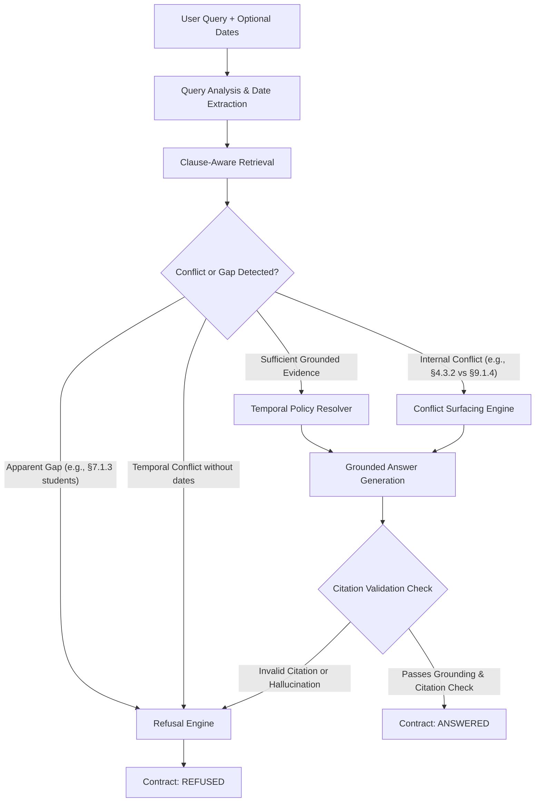

# Requirements Analysis — The Grounded Answer
**An Evidence-Grounded Policy Intelligence Assistant**  
*Document Version: 1.0.0 — Phase 0 Analysis*  
*Authoritative Scope: Calder County Household Support Program (HSP)*

---

## 1. Executive Summary & Purpose

The **Grounded Answer** is an evidence-grounded policy intelligence assistant engineered specifically for caseworkers administering the **Calder County Household Support Program (HSP)**. 

In public benefit administration, the consequences of a fluent, confident, but legally or procedurally inaccurate response are severe: eligible families may be wrongly denied life-saving support, or ineligible households may receive awards that subsequently trigger devastating overpayment recovery processes.

The primary objective of the Grounded Answer is **not** to operate as an unconstrained conversational chatbot. Rather, it is designed to:
1. **Answer only what can be proven:** Ground every substantive policy statement in exact, verifiable statutory and policy clauses.
2. **Handle temporal policy evolution:** Dynamically resolve whether pre-amendment rules, post-amendment rules, or transitional provisions govern a claim based on claim dates, determination dates, and change-of-circumstances dates.
3. **Detect ambiguity and internal conflict:** Surface contradictions in the manual rather than silently choosing a side.
4. **Enforce responsible refusal:** Know the precise boundary of its authority, actively declining to answer when the text does not settle a matter or when critical facts are missing, and directing the caseworker to appropriate human supervisory or appeals channels.

---

## 2. Authoritative Corpus & Inventory

The system operates under an absolute **Single Source of Truth** doctrine. General external knowledge, rules from other jurisdictions, and AI prior training assumptions are strictly quarantined and prohibited from determining eligibility or award calculations.

### 2.1 Supplied Material Inventory

| Identifier | Document Name | Format | Status & Scope |
|:---|:---|:---|:---|
| **DOC-01** | `policy-manual.md` | Markdown | Consolidated text as at 31 December 2025 (12 Parts, 148 clauses). Primary corpus baseline. |
| **DOC-02** | `Amendment No. 2026-01.md` | Markdown | Issued 12 Feb 2026, Effective 1 Mar 2026. Effective-dated overlay amending specific clauses and introducing transitional rules. |
| **DOC-03** | `1 - The Grounded Answer.docx` | OpenXML Word | Primary Problem Specification (Floor, goals, constraints, rubric). |
| **DOC-04** | `Data pack/README.md` | Markdown | Corpus background notes, chunking suggestions, single source of truth warning. |
| **DOC-05** | `READ ME FIRST.md` (Surprise Challenge) | Markdown | Day Two Amendment instructions, temporal requirement shift, decision documentation requirement. |

### 2.2 Corpus Invariants
- **Original Policy Integrity:** `policy-manual.md` remains immutable. It is never overwritten, modified in place, or destructively merged.
- **Effective-Dated Overlay:** `Amendment No. 2026-01.md` is ingested as a distinct legal overlay with explicit temporal metadata (Issue Date: 12 February 2026; Effective Date: 1 March 2026).
- **Exact Citation Identifiers:** Every clause maintains its canonical identifier in the form `§X.Y.Z` (Part `X`, Section `Y`, Paragraph `Z`), e.g., `§4.3.2`, or amended insertions such as `§10.5.3A`.

---

## 3. Core Answer Contract

Every user query submitted to the system must deterministically terminate in one of two principal contract states: **ANSWERED** or **REFUSED**. A hybrid state **ANSWERED_WITH_WARNING** is permitted when an answer is grounded but temporal caveats or pending supervisory referrals exist.

### 3.1 Contract State: ANSWERED
Returned **only** when all factual and legal claims are fully substantiated by retrieved clauses.

**Required Response Structure:**
1. **Direct Answer:** A concise, definitive statement answering the question.
2. **Policy Explanation:** Step-by-step reasoning distinguishing mandatory duties ("must"), discretionary powers ("may"), and standard practices ("should") under §1.3.1.
3. **Exact Supporting Clauses:** List of canonical citations (`§X.Y.Z`) with verbatim quoted policy snippets.
4. **Temporal Context:** The resolved policy version (Consolidated 2025 vs. Amendment 2026-01), effective dates applied, and date logic used.
5. **Warnings / Caveats:** Any conditional requirements, such as mandatory supervisor referrals (§2.3.2, §5.5.2, §8.3.3, §9.6.2, §10.2.3) or apportionment under §7.4.3.

### 3.2 Contract State: REFUSED
Returned whenever evidence is insufficient, ambiguous, contradictory without temporal resolution, outside the manual's scope, or when essential case facts are missing.

**Required Response Structure:**
1. **Refusal Status:** Explicit indicator (`REFUSED`).
2. **Refusal Category:** Categorized reason (e.g., `OUT_OF_SCOPE`, `INSUFFICIENT_EVIDENCE`, `APPARENT_GAP`, `AMBIGUOUS_POLICY`, `UNRESOLVED_TEMPORAL_CONTEXT`, `MISSING_CASE_FACTS`).
3. **Explanation:** Plain-language statement explaining why the manual cannot settle the matter.
4. **Partial Relevant Clauses (if any):** Clauses that discuss related principles, clarifying the boundary where the policy stops.
5. **Missing Information:** Concrete details or facts needed to proceed (e.g., date of change of circumstances, date of determination).
6. **Recommended Next Step:** Actionable guidance on who to consult (e.g., "Refer case to District Office Supervisor under §1.1.3", "Seek legal advice from Appeals Panel under §12.1", or "Request client documentation under §8.2").

---

## 4. Detailed Functional Requirements

### 4.1 Temporal Policy & Transitional Reasoning
The system must faithfully implement the complex temporal mechanisms introduced by Amendment No. 2026-01:

1. **Paragraph 5.1 Rules (Determination Date Rule):**
   - Applies to: Earnings disregard (§6.4.1(a)), Income thresholds (§6.6.1), and Sanction percentages/exceptions (§10.5.2, §10.5.3A).
   - Trigger: Applied to **any determination made on or after 1 March 2026**, even if the period under consideration arose before that date.
2. **Paragraph 5.2 Rules (Occurrence Date Rule):**
   - Applies to: Reporting period for changes of circumstances (§4.3.2 and §9.1.4).
   - Trigger: Applied **strictly based on the date the change occurred**, irrespective of when the determination is made.
   - Pre-1 March 2026 changes: Bound by pre-amendment reporting periods (§4.3.2 required 10 calendar days; §9.1.4 referenced 30 calendar days).
   - On or after 1 March 2026 changes: Bound by 14 calendar days.
3. **Paragraph 5.3 Rules (Spanning Claims Rule):**
   - Applies to: Claims spanning 1 March 2026.
   - Mechanism: Applicable figures are those in force on each day of the period, apportioned by reference to the number of days under §7.4.3. No invented formulas.
4. **Missing Dates Handling:**
   - If a query asks a rate- or timeline-sensitive question without specifying dates, the system must **not** assume today's date. It must either present both historical and amended rules with explicit date conditions or refuse until the determination/occurrence date is specified.

### 4.2 Handling Inconsistencies and Apparent Gaps
The system must specifically address the planted traps in the Calder County policy manual:

1. **The Reporting Contradiction (§4.3.2 vs §9.1.4):**
   - In the pre-amendment manual, §4.3.2 commands reporting within **10 calendar days**, whereas §9.1.4 states: *"the 30 calendar days required under §4.3"*.
   - Behavior: For pre-1 March 2026 determinations or pre-1 March changes, the system must surface both provisions explicitly, highlight the draftsmanship conflict, and recommend referral to a supervisor.
2. **The Full-Time Student Apparent Gap (§1.4.6, §3.2.3, §5.2.3, §7.1.3):**
   - §1.4.6 defines a full-time student; §3.2.3/§5.2.3 declare educational absences are addressed separately; §7.1.3 states: *"The needs figure is calculated... except in the case of full-time students (see §5.4)"*.
   - However, §5.4 is titled *"Households including a person in receipt of a care allowance"* and contains zero provisions regarding students!
   - Behavior: When asked how full-time students are treated for needs calculation or living allowances, the system must **refuse**, explicitly note that §7.1.3 cross-references §5.4 mistakenly, and advise escalating to program policy management.

### 4.3 Mandatory Referral Escalations
The manual mandates specific supervisor referrals. The system must automatically flag these requirements when relevant:
- Applicants under 18 (§2.3.2).
- Household members subject to immigration conditions prohibiting recourse to public assistance (§5.5.2).
- Applications undetermined after 90 days (§8.3.3).
- Findings of deliberate misrepresentation (§9.6.2).
- Suspensions continuing for 60 days without resolution (§10.2.3).

---

## 5. Non-Negotiable Operational & Quality Rules

1. **Incremental Phased Development:** Strictly follow Phases 0 through 10. No jumping ahead. Each phase requires an exhaustive completion report and user approval.
2. **Documentation Integrity:** All existing source files remain untouched.
3. **No Hallucinations or Fabricated Metrics:** Evaluation scores, citations, and answers must be 100% genuine and reproducible.
4. **Provider-Agnostic LLM Adapter:** Support OpenAI, Gemini, Groq, Ollama, and a fully **Deterministic Mock Provider** enabling complete end-to-end execution and testing without API keys.
5. **Dual Interface:** Both a modern web application (React/TS/Tailwind) and an interactive CLI (`scripts/run_cli.py`) must be fully maintained.
6. **Zero Secrets in Client:** Environment variables strictly isolated to backend.
7. **Clean Clone Reproducibility:** The repository must run out of the box following `README.md`.

---

## 6. Evaluation Framework Specification

The floor requires a dedicated, reproducible **Ten-Question Evaluation Suite** covering diverse policy scenarios:

| Test ID | Evaluation Category | Policy Area | Key Challenge / Trap | Expected Outcome |
|:---|:---|:---|:---|:---|
| **TEST-01** | Direct Grounded Query | Resource limits (§2.4) | Standard eligibility rules | ANSWERED (§2.4.1, §2.4.2) |
| **TEST-02** | Multi-Clause Reasoning | Under-18 applicant (§2.1, §2.3) | Requires combining conditions + supervisor referral | ANSWERED with Warning (§2.1.2(b), §2.3.1, §2.3.2) |
| **TEST-03** | Pre-Amendment Rates | Earnings disregard pre-Mar 2026 | Determination date = Feb 2026 | ANSWERED ($120/mo under §6.4.1(a)) |
| **TEST-04** | Post-Amendment Rates | Earnings disregard post-Mar 2026 | Determination date = Mar 2026 | ANSWERED ($175/mo under Amd 1.1 / §6.4.1(a)) |
| **TEST-05** | Transitional Split Rule | Change occurred in Feb, determined in Mar | Para 5.1 vs Para 5.2 divergence | ANSWERED (Reporting: 10/30 days per 5.2; Disregard: $175 per 5.1) |
| **TEST-06** | Spanning Claim Apportionment | Claim spanning 15 Feb to 15 Mar 2026 | Apportionment calculation per Para 5.3 & §7.4.3 | ANSWERED with daily breakdown formula |
| **TEST-07** | Internal Inconsistency | Change reporting timeline pre-Mar 2026 | §4.3.2 (10 days) vs §9.1.4 (30 days) | REFUSED / WARNING (Surfacing contradiction) |
| **TEST-08** | Apparent Gap Detection | Full-time student award calculation | §7.1.3 refers to care allowance in §5.4 | REFUSED (Explaining broken reference) |
| **TEST-09** | Completely Out of Scope | Commercial business grant eligibility | Topic absent from HSP manual | REFUSED (Out of scope) |
| **TEST-10** | Missing Critical Dates | "What is the monthly income threshold for a family of 3?" | Threshold changes on 1 Mar 2026 ($2,000 vs $2,075) | REFUSED or COMPARATIVE (Requires determination date) |

---

## 7. Deliverables Summary for Phase 0

1. `docs/requirements-analysis.md` (This document)
2. `docs/policy-structure.md` (Exhaustive clause map of all 12 Parts, definitions, and cross-references)
3. `docs/amendment-analysis.md` (Detailed analysis of Amendment No. 2026-01 and temporal matrix)
4. `docs/architecture.md` (Complete full-stack system architecture, component breakdown, and contracts)

